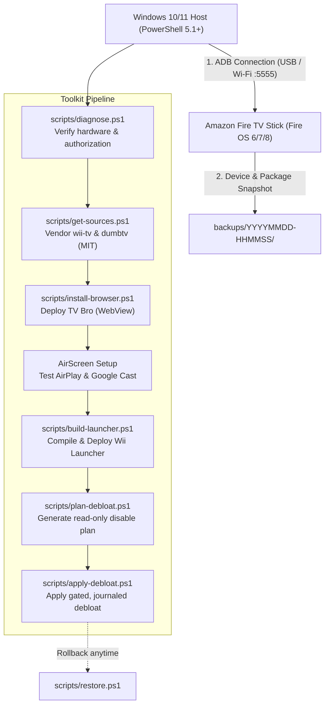

# 🎮 firestick-wii

[](https://github.com/rkohnmn/firestick-wii/actions/workflows/build-launcher.yml)
[](LICENSE)
[](https://microsoft.com)
[](https://amazon.com)
[](#-safety--reversibility-guarantees)

> **Transform your Amazon Fire TV Stick into an ultra-clean Nintendo Wii-style entertainment console** — safely, reversibly, and without rooting, bootloader unlocking, or firmware flashing.

---

## 📋 Table of Contents

- [Overview](#-overview)
- [Key Features](#-key-features)
- [Architecture & Workflow](#-architecture--workflow)
- [Prerequisites & Checklist](#-prerequisites--checklist)
- [Quick Start](#-quick-start)
- [What the Toolkit Does](#-what-the-toolkit-does-step-by-step)
- [Core Components](#-core-components)
  - [1. Wii TV Launcher](#1-wii-tv-launcher-iogithubfirestickwii)
  - [2. TV Bro Web Browser](#2-tv-bro-web-browser)
  - [3. Dual Phone Screen Mirroring](#3-dual-phone-screen-mirroring-pixel--iphone)
  - [4. Reversible Debloat Engine](#4-reversible-debloat-engine)
- [Modular Script Reference](#-modular-script-reference)
- [Building from Source](#-building-from-source)
  - [Cloud Build (GitHub Actions)](#cloud-build-github-actions)
  - [Local Build (Windows)](#local-build-windows)
- [Safety & Reversibility Guarantees](#-safety--reversibility-guarantees)
- [Troubleshooting & Diagnostics](#-troubleshooting--diagnostics)
- [Repository Structure](#-repository-structure)
- [Credits & Upstream Provenance](#-credits--upstream-provenance)
- [Disclaimer](#-disclaimer)

---

## 🌟 Overview

The **firestick-wii** toolkit brings the classic, nostalgic Nintendo Wii Channel Menu to the Amazon Fire TV Stick. Beyond just visual theming, this project bundles a carefully architected suite of tools designed to optimize performance on resource-constrained Fire TV hardware, provide lightweight modern web browsing, enable dual screen mirroring (iOS & Android), and selectively disable background telemetry and clutter without risking a brick.

> [!IMPORTANT]
> **Zero Root / Zero Flash**: This toolkit operates purely over standard user-space Android Debug Bridge (ADB). It **never** flashes ROMs, alters bootloaders, uses MediaTek preloader tools, or performs factory wipes. Your stock Amazon Home and all core hardware features remain intact.

---

## 🚀 Key Features

| Feature | Description |
| :--- | :--- |
| **🕹️ Wii Channel Interface** | Nostalgic Wii Channel grid, D-pad navigation, sound effects, and dedicated app tiles customized specifically for Fire TV. |
| **🌐 Lightweight Web Browser** | Installs [TV Bro](https://github.com/truefedex/tv-bro) (WebView variant) — optimized for remote control navigation, fast loading, and minimal RAM footprint. |
| **📱 Dual Screen Mirroring** | Step-by-step verified integration for both **Apple AirPlay** (iPhone / iPad / Mac) and **Google Cast** (Pixel / Android) via official AirScreen. |
| **🛡️ 100% Reversible Debloat** | Conservative disable-only debloat engine inspired by `dumbtv`. Uses `pm disable-user` (never `pm uninstall`). Pre-change state snapshots are recorded for instant 1-click restore. |
| **🔒 Preserved Core Services** | Stock Amazon Home, physical remote pairing, Bluetooth, Wi-Fi, SystemUI, Settings, and DRM streaming apps (Netflix, Prime Video, etc.) are strictly protected. |
| **⚙️ Cloud & Local Build** | Build the launcher APK locally with JDK 17 + Android SDK 34 or let the included **GitHub Actions CI** compile it directly in the cloud. |

---

## 🏗️ Architecture & Workflow



---

## 📦 Prerequisites & Checklist

### Hardware Requirements
- [x] **Amazon Fire TV Stick** (running Android 8.0 / Fire OS 6 or newer).
- [x] **Television or Display with HDMI** connected directly to the Fire Stick.
  > [!NOTE]
  > PC HDMI ports on laptops and graphics cards are video **outputs**, not inputs. You must plug the Stick into a TV or capture device.
- [x] **Stable Power Supply** (original Amazon wall adapter recommended; PC USB ports may underpower the Stick).
- [x] **Working Remote Control** (Fire TV Remote, HDMI-CEC TV remote, or Fire TV Mobile App on the same Wi-Fi).

### Software Requirements (Windows 10 / 11)
- [x] **PowerShell 5.1** or PowerShell 7+
- [x] **Android SDK Platform-Tools (`adb`)** added to system `PATH`
- [x] **Git** installed and on `PATH`
- [x] *(Optional for local APK compilation)*: **JDK 17** (or Android Studio JBR) + **Android SDK Platform 34** & **Build-Tools 34.0.0** (otherwise use [GitHub Actions CI](#cloud-build-github-actions)).

---

## ⚡ Quick Start

### Method 1: The One-Click Interactive Setup

1. Connect your Fire Stick to your TV HDMI and turn on power.
2. Enable **Developer Options** and **ADB Debugging** on the Fire TV:
   - Navigate to `Settings` > `My Fire TV` > `About`.
   - Click the device name 7 times until it says *"You are now a developer"*.
   - Go back to `Developer Options` and toggle **ADB Debugging** to **ON**.
3. Note your Fire Stick's IP address (`Settings` > `My Fire TV` > `About` > `Network`).
4. In this repository on Windows, launch PowerShell and run:

```powershell
powershell.exe -NoProfile -ExecutionPolicy Bypass -File .\setup.ps1 -FireTvIp 192.168.1.50
```
*(Replace `192.168.1.50` with your Stick's actual local IP address.)*

> [!TIP]
> If your Stick is connected via a data-capable Micro-USB cable directly to your PC and recognized by ADB, you can simply double-click `run.bat` or omit the `-FireTvIp` argument.

---

## 🔍 What the Toolkit Does (Step-by-Step)

The automated wizard walks through seven explicit safety gates:

1. **Hardware & ADB Diagnostics**: Checks connection status, verifies device manufacturer is Amazon, ensures OS API >= 26, and refuses unauthorized/preloader states.
2. **Pre-Flight Snapshot**: Saves full list of installed packages, disabled packages, global/secure settings, storage, and home activity to a timestamped folder in `backups/`.
3. **Vendored Source Verification**: Fetches and vendors official MIT-licensed `wii-tv` and `dumbtv` source snapshots into `third_party/` with LICENSE files preserved.
4. **TV Bro Browser Installation**: Downloads verified official TV Bro v2.1.6 `geckoExcluded` APK, checks SHA-256 integrity, installs it, and prompts you to test navigation on your TV.
5. **Screen Mirroring Setup**: Guides you to install official AirScreen from the Amazon Appstore and verify both Apple AirPlay (iPhone/iPad) and Google Cast (Pixel/Android).
6. **Wii Launcher Build & Deployment**: Patches `wii-tv` for Fire TV settings intent handling and non-leanback app discovery, compiles with unique ID `io.github.firestickwii`, installs it, and launches it for manual validation.
7. **Gated, Reversible Debloat**: Generates a read-only debloat proposal from `dumbtv`'s package list. Requires you to explicitly type `REVIEWED` before disabling anything.

---

## 🧩 Core Components

### 1. Wii TV Launcher (`io.github.firestickwii`)
- **Upstream Source**: Based on [wii-tv](https://github.com/MauroProto/wii-tv) by MauroProto (MIT License).
- **Custom Application ID**: Configured with `io.github.firestickwii` to avoid package collisions.
- **Fire TV Settings Intent Fallback**: Automatically falls back from `android.settings.LEANBACK_SETTINGS` to `com.amazon.tv.settings` or `Settings.ACTION_SETTINGS`.
- **Hybrid App Discovery**: Discovers both Android TV Leanback activities and standard launcher apps (allowing TV Bro and side-loaded tools to appear cleanly).
- **Resource Optimization**: Configured with reduced motion, disabled background dithering, and disabled heavy card animations for lag-free rendering on Fire Stick processors.

### 2. TV Bro Web Browser
- **Upstream Source**: [TV Bro](https://github.com/truefedex/tv-bro) by Phlox (v2.1.6).
- **WebView Variant (`geckoExcluded`)**: Leverages the system's hardware-accelerated Android System WebView rather than bundling an 80MB Gecko engine. This saves flash storage and operational RAM.
- **Built-in D-Pad Navigation**: Optimized for remote control directional keys with virtual cursor overlay, bookmarking, and tab management.

### 3. Dual Phone Screen Mirroring (Pixel + iPhone)
- **Application**: AirScreen by Ionitech (available officially in Amazon Appstore).
- **Protocols Supported**:
  - 🍏 **Apple AirPlay**: iOS Control Center > Screen Mirroring (iPhone, iPad, Mac).
  - 🤖 **Google Cast**: Android Quick Settings > Cast / Google Home (Pixel, Galaxy, Android phones, Chrome browser).
- **Network Note**: Ensure both Fire TV and your mobile devices are on the same Wi-Fi subnet (disable "AP / Client Isolation" on your router).

### 4. Reversible Debloat Engine
- **Upstream Reference**: Curated package definitions from [dumbtv](https://github.com/humblemuzzu/dumbtv) (MIT License).
- **Safety First**:
  - Uses `pm disable-user --user 0`, **never** `pm uninstall`.
  - Never touches Amazon stock HOME, Bluetooth remote services, Wi-Fi drivers, SystemUI, or Settings.
  - Leaves user streaming apps (Netflix, Disney+, Prime Video, YouTube, etc.) untouched.
  - Does **not** block OTA firmware updates by default to prevent unpatched WebView vulnerabilities.

---

## 🛠️ Modular Script Reference

Each step can be executed individually from PowerShell:

```powershell
# 1. Diagnose connection and verify ADB state (read-only):
powershell -File .\scripts\diagnose.ps1 -FireTvIp 192.168.1.50

# 2. Fetch and vendor upstream third-party sources:
powershell -File .\scripts\get-sources.ps1

# 3. Patch and prepare Wii launcher source tree for Fire OS:
powershell -File .\scripts\prepare-launcher.ps1

# 4. Install TV Bro browser (with hash verification):
powershell -File .\scripts\install-browser.ps1 -FireTvIp 192.168.1.50

# 5. Build and install custom Wii launcher:
powershell -File .\scripts\build-launcher.ps1 -FireTvIp 192.168.1.50

# 6. Attempt standard HOME activity registration (never disables stock HOME):
powershell -File .\scripts\activate-home.ps1 -FireTvIp 192.168.1.50

# 7. Generate a read-only debloat preview plan:
powershell -File .\scripts\plan-debloat.ps1 -FireTvIp 192.168.1.50

# 8. Apply debloat plan (requires explicit confirmation token):
powershell -File .\scripts\apply-debloat.ps1 -FireTvIp 192.168.1.50

# 9. Verify device configuration and installed apps:
powershell -File .\scripts\verify.ps1 -FireTvIp 192.168.1.50

# 10. Instant Rollback: Restore all packages modified by this toolkit:
powershell -File .\scripts\restore.ps1 -FireTvIp 192.168.1.50
```

---

## 🏗️ Building from Source

### Cloud Build (GitHub Actions)

This repository includes a fully configured automated GitHub Actions workflow: [`.github/workflows/build-launcher.yml`](.github/workflows/build-launcher.yml).

1. Push this repository to your GitHub account.
2. In your repo on GitHub, go to **Actions** > **Build Wii launcher APK**.
3. Click **Run workflow**.
4. Once completed, download the signed release artifact from the workflow run summary (`firestick-wii-unsigned-release-debugkey`).

### Local Build (Windows)

To build the launcher APK locally on your Windows machine:
1. Ensure **JDK 17** is installed:
   ```powershell
   java -version
   ```
2. Ensure Android SDK Platform `android-34` and `build-tools;34.0.0` are installed:
   ```powershell
   $env:ANDROID_HOME = "C:\Users\YOUR_USER\AppData\Local\Android\Sdk"
   ```
3. Run the build script:
   ```powershell
   powershell -File .\scripts\build-launcher.ps1 -FireTvIp 192.168.1.50
   ```

---

## 🛡️ Safety & Reversibility Guarantees

> [!CAUTION]
> Many online Fire TV debloat guides issue reckless `pm uninstall` commands or disable critical system frameworks, leading to bricked devices or broken remotes. **firestick-wii is built with strict safety boundaries:**

- **Read-Only First**: Every operational change begins with an inventory capture and a read-only proposal.
- **`disable-user` Instead of `uninstall`**: Any altered package can be instantly revived with `pm enable`.
- **Zero Amazon Home Sabotage**: Stock Home (`com.amazon.tv.launcher`) remains enabled at all times. If you ever want to return to stock Fire OS, simply launch stock Home or reboot.
- **Protected System Packages**: Remote control daemons (`com.amazon.device.rdm`), Bluetooth, Wi-Fi, SystemUI, Package Installer, Settings, and Android WebView are hardcoded as protected and cannot be disabled.
- **One-Command Restore**: Running `scripts/restore.ps1` reads your session journal and immediately re-enables all packages disabled during that session.

---

## ❓ Troubleshooting & Diagnostics

| Issue | Cause | Solution |
| :--- | :--- | :--- |
| `No authorized Android ADB device` | ADB debugging disabled or on-screen prompt not accepted | Turn on ADB debugging on TV (`Settings` > `My Fire TV` > `Developer Options`). Check TV screen for *"Allow USB debugging?"* prompt and select **Always allow**. |
| `Device detected as MT65xx Preloader` | PC detected low-level USB bootloader, not Android OS | Boot the Fire Stick fully into Fire OS connected to a TV. Preloader drivers cannot be used with this toolkit. |
| `Physical Remote Not Responding` | Fire TV remote lost Bluetooth pairing | Use a TV remote with **HDMI-CEC**, connect the **Fire TV Mobile App** on your smartphone, or attach a USB OTG keyboard. |
| `Home Button Returns to Amazon Home` | Fire OS firmware blocks third-party default launcher override | Modern Fire OS versions aggressively defend their default launcher. Launch the Wii app from your recent apps or app library. Stock Home is intentionally kept safe. |
| `AirPlay / Cast Not Discoverable` | Router Wi-Fi client isolation or separate SSIDs | Connect both your Fire Stick and phone to the same 2.4GHz or 5GHz Wi-Fi band. Ensure "AP Isolation" / "Client Isolation" is turned OFF in router settings. |
| `TV Bro Video DRM Black Screen` | Protected DRM video streams (e.g., Widevine L1) in browser | Use the official native streaming app (Netflix, Prime Video) rather than the web browser for protected copyright media. |

---

## 📁 Repository Structure

```
firestick-wii/
├── .github/
│   └── workflows/
│       └── build-launcher.yml    # Automated cloud APK build workflow
├── config/
│   └── preferences.json          # Configuration parameters & app IDs
├── docs/
│   ├── SAFETY.md                 # Detailed safety bounds & limits
│   └── TEST-MATRIX.md            # Hardware & feature test verification matrix
├── scripts/
│   ├── activate-home.ps1         # Standard Android HOME assignment attempt
│   ├── apply-debloat.ps1         # Gated debloat execution with logging
│   ├── build-launcher.ps1        # Gradle compile and deployment runner
│   ├── common.ps1                # Core ADB wrappers, logging, and error handling
│   ├── diagnose.ps1              # Network and USB connection diagnostics
│   ├── get-sources.ps1           # Clones & vendors upstream wii-tv & dumbtv
│   ├── install-browser.ps1       # TV Bro download and verification
│   ├── plan-debloat.ps1          # Generates read-only debloat proposal
│   ├── prepare-launcher.ps1      # Patches Java & XML for Fire TV optimization
│   ├── restore.ps1               # Rollback engine to re-enable altered packages
│   ├── self-test.ps1             # Local static configuration checker
│   └── verify.ps1                # Verifies device state post-install
├── third_party/                  # Vendored upstream sources (MIT licensed)
│   ├── dumbtv/                   # Upstream package list snapshot
│   └── wii-tv/                   # Upstream launcher source snapshot
├── .gitignore                    # Prevents backups, logs, and build artifacts from committing
├── AGENTS.md                     # Strict development guidelines for AI assistants
├── LICENSE                       # MIT License
├── README.md                     # You are here!
├── run.bat                       # One-click Windows batch launcher
├── setup.ps1                     # Main guided interactive PowerShell installer
└── START_HERE.txt                # Plain-text quick start guide
```

---

## 👏 Credits & Upstream Provenance

- **[wii-tv](https://github.com/MauroProto/wii-tv)** by [MauroProto](https://github.com/MauroProto) (based on work by Gathin / cleanyourtv) — Licensed under MIT. Provides the core Wii Menu launcher codebase.
- **[dumbtv](https://github.com/humblemuzzu/dumbtv)** by [humblemuzzu](https://github.com/humblemuzzu) — Licensed under MIT. Provides curated Fire OS package inventories and preflight checks.
- **[TV Bro](https://github.com/truefedex/tv-bro)** by [Phlox](https://github.com/truefedex) — Licensed under AGPL-3.0. Lightweight, remote-optimized Android TV web browser.
- **[AirScreen](https://www.airscreen.app/)** by Ionitech — Proprietary casting receiver installed directly from the Amazon Appstore.

---

## ⚖️ Disclaimer

*firestick-wii is an independent fan-made integration toolkit. It is **not** endorsed by, directly affiliated with, maintained, authorized, or sponsored by Nintendo Co., Ltd., Amazon.com, Inc., or any of their affiliates or subsidiaries. All product and company names are the registered trademarks of their original owners.*

